# Java class structure and OOP

```mermaid
classDiagram
    class GameServer {
        +main(args) void
    }
    class MessageHandler {
        +register(config)
        -RoomManager rooms
    }
    class RoomManager {
        -Map rooms
        -Map players
        -AccountManager accounts
        -RoomCodeGenerator codeGenerator
        +connect(context, token)
        +handleMessage(playerId, json)
        +tick()
    }
    class RoomCodeGenerator {
        +next(alreadyExists) String
    }
    class GameRoom {
        -Map players
        -List snowballs
        -List powerUps
        -int scoreGoal
        -String status
        +tick(seconds)
        +snapshot(includeArena) Map
    }
    class PlayerState {
        -double health
        -int score
        -double x
        -double z
        -double yaw
        -double moveYaw
        -double aimYaw
        -double aimPitch
        -MovementController movement
        +takeDamage(amount) boolean
        +tick(seconds, arena, collisions)
        +powerUpSnapshot() Map
    }
    class MovementController {
        -MovementState state
        -SnowmanVariant variant
        -double dashDirectionX
        -double dashDirectionZ
        -long dashCooldownUntilMillis
        +setRequests(crouch, dash)
        +tick(now, x, z, moveX, moveZ, yaw, arena, collisions)
        +getSpeedMultiplier(now) double
        +getHitboxHeight(now) double
    }
    class MovementState {
        <<enumeration>>
        STANDING
        CROUCHING
        DASHING
        +speedMultiplier() double
        +hitboxHeight() double
        +throwHeight() double
    }
    class SnowmanVariant {
        <<enumeration>>
        CLASSIC
        TALL
        WIDE
        -double baseRadius
        -double torsoRadius
        -double headRadius
        -double hitboxRadius
        -double hitboxHeight
        +snapshot() Map
        +fromKey(key) SnowmanVariant
    }
    class SnowmanRig {
        -Group hips
        -Group torsoPivot
        -Group neck
        -Group headPivot
        -List legs
        -List arms
        +checkRigConnections() boolean
    }
    class SnowmanAnimator {
        -double phase
        -double idleSeconds
        -String current
        +advance(dt, distance, variant, moving) double
        +transition(next, now)
        +blend(now) double
    }
    class MovementConfig {
        <<utility>>
        +BASE_SPEED
        +DASH_COOLDOWN_MILLIS
        +snapshot() Map
    }
    class ArenaMap {
        -MapDefinition definition
        +getWorldWidth() double
        +getWorldDepth() double
        +getWalls() List
        +placeAtSpawn(player, seat)
        +snapshot() Map
    }
    class MapDefinition {
        -String id
        -double worldWidth
        -double worldDepth
        -List~Wall~ walls
        -List~SpawnPoint~ spawnPoints
        -List~PickupSpawn~ pickupSpawns
        +load() MapDefinition
        +snapshot() Map
    }
    class Wall {
        <<abstract>>
        -String id
        -double x
        -double z
        -double width
        -double depth
        -double height
        +snapshot() Map
    }
    class PerimeterWall
    class Barrier
    class SidePost
    class IceBlock
    class SpawnPoint
    class PickupSpawn
    class Decoration
    class MapGenerator {
        +generate(legacySize) ArenaMap
    }
    class CollisionSystem {
        +playerBlocked(arena, x, z, radius) boolean
        +playerBlocked(arena, x, z, radius, height) boolean
        +canStandUp(arena, x, z, radius, currentHeight, standingHeight) boolean
        +bounceSnowball(arena, ball, oldX, oldZ) boolean
    }
    class SnowballState {
        -boolean critical
        -double damage
        -int bouncesLeft
        -double originHeight
        -double launchDelayRemaining
        +advance(seconds)
        +snapshot() Map
    }
    class AimResolver {
        <<utility>>
        +angleDiff(from, to) double
        +lerpAngle(from, to, amount) double
        +resolve(hand, target, fallbackYaw) Direction
        +wallBlocksSegment(wall, from, to, radius) boolean
        +canHitPlayer(ownerId, targetId) boolean
    }
    class PowerUp {
        <<abstract>>
        -String id
        -double x
        -double z
        +getType() String
        +applyTo(player)*
        +snapshot() Map
    }
    class SpeedBoost
    class StrongSnowball
    class Shield
    class HealPack
    class ExtraLife
    class AccountRoutes {
        +register(config)
    }
    class AccountManager {
        -Map accounts
        -Map sessions
        +register(username, password) Map
        +login(username, password) Map
        +update(token, profile) Map
        +recordMatch(token, score, won)
    }
    class Account {
        -String username
        -String passwordHash
        -int wins
        -int totalScore
        -int gamesPlayed
    }
    class SnowmanLook {
        +isValid() boolean
    }
    class ScreenFlow {
        -ScreenState state
        -ScreenState returnState
        +play(hasValidSession) ScreenState
        +loginSucceeded() ScreenState
        +enterLobby() ScreenState
        +enterGame() ScreenState
        +roomLeft() ScreenState
        +logout() ScreenState
        +requestQuit() ScreenState
        +cancelQuit() ScreenState
        +confirmQuit() ScreenState
        +playAgain() ScreenState
    }
    class ScreenState {
        <<enumeration>>
        TITLE
        LOGIN
        MENU
        LOBBY
        GAME
        QUIT_CONFIRM
        THANKS
    }
    class TitleSceneRenderer {
        -WebGLRenderer renderer
        -Scene scene
        -Object3D model
        -SnowmanAnimator animator
        +show()
        +render(dt, now)
        +resize()
        +hide()
        +destroy()
    }

    GameServer --> MessageHandler
    MessageHandler --> RoomManager
    RoomManager *-- GameRoom
    RoomManager --> AccountManager
    RoomManager --> RoomCodeGenerator
    GameRoom *-- PlayerState
    PlayerState *-- MovementController
    MovementController --> MovementState
    MovementController --> MovementConfig
    MovementController --> SnowmanVariant : collider and speed profile
    GameRoom --> MovementConfig : snapshot tuning
    GameRoom *-- SnowballState
    GameRoom --> AimResolver : resolves throw direction and swept wall checks
    PlayerState --> AimResolver : shared yaw and owner-hit rules
    GameRoom *-- PowerUp
    GameRoom --> ArenaMap
    GameRoom --> CollisionSystem
    MovementController --> CollisionSystem : validates wall clearance
    MapDefinition *-- Wall : builds shared collision geometry
    Wall <|-- PerimeterWall
    Wall <|-- Barrier
    Wall <|-- SidePost
    Wall <|-- IceBlock
    MapDefinition *-- SpawnPoint
    MapDefinition *-- PickupSpawn
    MapDefinition *-- Decoration
    ArenaMap o-- MapDefinition
    MapGenerator ..> MapDefinition : loads Christmas arena
    MapDefinition ..> christmas_arena.json : reads scaled source
    PowerUp <|-- SpeedBoost
    PowerUp <|-- StrongSnowball
    PowerUp <|-- Shield
    PowerUp <|-- HealPack
    PowerUp <|-- ExtraLife
    PowerUp --> PlayerState : applies effect
    AccountRoutes --> AccountManager
    AccountManager *-- Account
    Account --> SnowmanLook
    ScreenFlow --> ScreenState : validates screen transitions
    TitleSceneRenderer --> SnowmanRig : builds title snowman via shared factory
    TitleSceneRenderer --> SnowmanAnimator : advances title idle and wave
```

## OOP notes

- **Classes and objects:** a `GameRoom` object owns the room state; its player, snowball, and pickup objects represent the live match.
- **Encapsulation:** gameplay and account fields are private. Other classes use methods such as `takeDamage`, `tick`, and `recordMatch` to make validated changes.
- **Constructors:** `PlayerState`, `GameRoom`, `SnowballState`, and pickup classes initialize each object's identity and starting state.
- **Inheritance and abstraction:** `PowerUp` defines shared pickup identity, location, snapshot, and the effect method. `SpeedBoost`, `StrongSnowball`, `Shield`, `HealPack`, and `ExtraLife` inherit it.
- **Polymorphism:** `GameRoom` calls `applyTo(player)` on the selected `PowerUp`; Java dispatches to that pickup's implementation without a type switch in the match loop.
- **Object interaction:** `RoomManager` routes client messages to `GameRoom`; the room advances `PlayerState`, `SnowballState`, `PowerUp`, and collision behavior and serializes snapshots.
- **Movement state:** `MovementController` owns each player's stance, requested transitions, headroom check, dash direction, and cooldown. `MovementState` carries the per-state speed, height, radius, throw height, and spread; `MovementConfig` serializes the same tuning to the browser.
- **Client animation:** Three.js `SnowmanRig` owns the linked body and limb pivots. `SnowmanAnimator` advances a distance-synced gait and eases pose changes for the local player, remote players, and lobby preview. Java `SnowmanVariant` publishes the matching proportions and server collider profile.
- **Persistence:** `AccountManager` owns account CRUD, salted password hashes, sessions, and JSON file writes; `AccountRoutes` exposes that behavior over HTTP.
- **Screen state:** the client-side `ScreenFlow` validates title, login, menu, lobby, gameplay, quit-confirmation, and thanks transitions. The view synchronizes DOM visibility from that state.
- **Title renderer:** `TitleSceneRenderer` creates an alpha WebGL renderer with capped pixel ratio, ambient key/rim light, a simple snowy base, and a snowman made by the same rig factory as the game. It disposes its model and renderer while hidden and uses the full menu artwork if WebGL setup fails.
