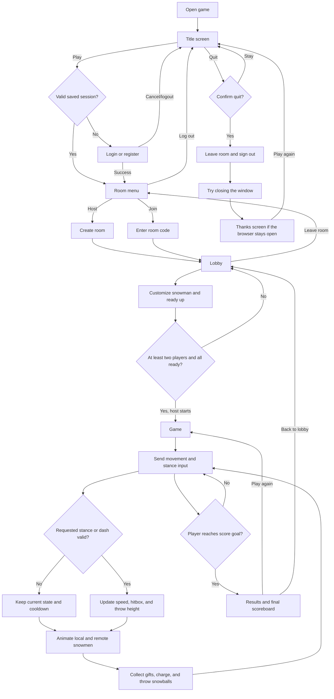

# Game flow

`ScreenFlow` owns the UI-level state transitions: `TITLE`, `LOGIN`, `MENU`, `LOBBY`, `GAME`, `QUIT_CONFIRM`, and `THANKS`. A saved account is validated only after the player selects Play, so the initial title remains visible on a fresh load. The title art and its separate lightweight Three.js snowman renderer are disposed while hidden; the existing game scene, account system, room protocol, and match loop retain their own responsibilities. The title uses a static full-art fallback when WebGL creation fails.

The browser sends input intent and displays snapshots. `RoomManager` and `GameRoom` remain authoritative for membership, readiness, movement, hits, power-ups, scoring, and results.
